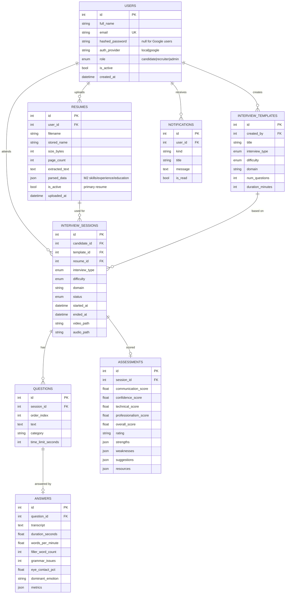

# 2. Database schema (finalized)

Implemented in `backend/app/models.py` (SQLAlchemy). Milestone 1 uses `users` and `resumes`; the rest are created now so later milestones don't need schema redesign.

Notes
- Deleting a user cascades to their resumes, templates, sessions and notifications.
- Deleting a resume keeps past sessions (`resume_id` set to NULL).
- Migrations: tables are auto-created now; switch to Alembic before the first real deployment.
