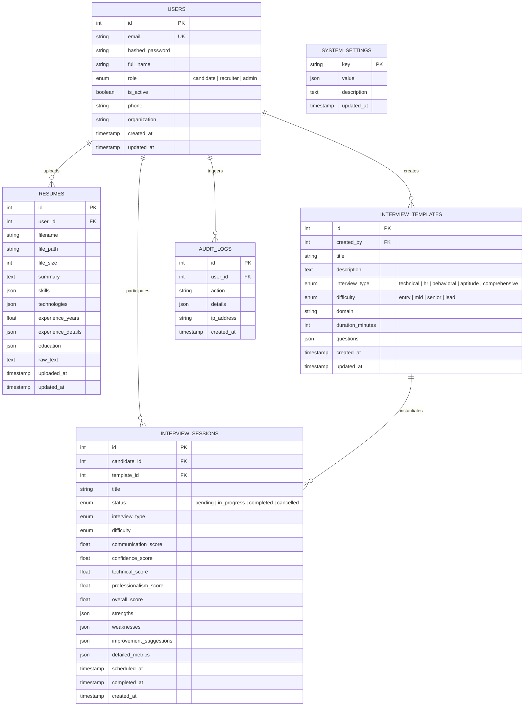

# SmartHire AI: Database Schema Specification

This document details the complete relational database schema design implemented for SmartHire AI, supporting both **PostgreSQL** in production/Docker and **SQLite** in development.

---

## 1. Entity-Relationship Diagram (ERD)

---

## 2. Table Definitions & Constraints

### 2.1 `users` Table
Stores authentication credentials, user profiles, and assigned access roles.
- `id` (INTEGER, Primary Key, Auto-increment)
- `email` (VARCHAR(255), Unique, Not Null, Indexed)
- `hashed_password` (VARCHAR(255), Not Null) - bcrypt hashed
- `full_name` (VARCHAR(255), Not Null)
- `role` (ENUM: `candidate`, `recruiter`, `admin`, Default: `candidate`, Not Null)
- `is_active` (BOOLEAN, Default: `True`, Not Null)
- `phone` (VARCHAR(50), Nullable)
- `organization` (VARCHAR(255), Nullable)
- `created_at` (TIMESTAMP, UTC Default)
- `updated_at` (TIMESTAMP, UTC Default)

### 2.2 `resumes` Table
Stores uploaded documents and AI-extracted skills and professional metadata.
- `id` (INTEGER, Primary Key, Auto-increment)
- `user_id` (INTEGER, Foreign Key -> `users.id` ON DELETE CASCADE, Not Null)
- `filename` (VARCHAR(255), Not Null)
- `file_path` (VARCHAR(500), Not Null)
- `file_size` (INTEGER, Default: 0)
- `summary` (TEXT, Nullable) - AI generated profile summary
- `skills` (JSON, Default: `[]`) - Extracted skill tokens
- `technologies` (JSON, Default: `[]`) - Detected tech stacks
- `experience_years` (FLOAT, Default: 0.0)
- `experience_details` (JSON, Default: `[]`)
- `education` (JSON, Default: `[]`)
- `raw_text` (TEXT, Nullable)
- `uploaded_at` (TIMESTAMP, UTC Default)
- `updated_at` (TIMESTAMP, UTC Default)

### 2.3 `interview_templates` Table
Templates configured by recruiters or admins for mock interview sessions.
- `id` (INTEGER, Primary Key, Auto-increment)
- `created_by` (INTEGER, Foreign Key -> `users.id` ON DELETE SET NULL, Nullable)
- `title` (VARCHAR(255), Not Null)
- `description` (TEXT, Nullable)
- `interview_type` (ENUM: `technical`, `hr`, `behavioral`, `aptitude`, `comprehensive`)
- `difficulty` (ENUM: `entry`, `mid`, `senior`, `lead`)
- `domain` (VARCHAR(100), Default: 'Software Engineering')
- `duration_minutes` (INTEGER, Default: 30)
- `questions` (JSON, Default: `[]`)
- `created_at` (TIMESTAMP, UTC Default)
- `updated_at` (TIMESTAMP, UTC Default)

### 2.4 `interview_sessions` Table
Candidate mock interview sessions and scoring evaluation records.
- `id` (INTEGER, Primary Key, Auto-increment)
- `candidate_id` (INTEGER, Foreign Key -> `users.id` ON DELETE CASCADE, Not Null)
- `template_id` (INTEGER, Foreign Key -> `interview_templates.id` ON DELETE SET NULL, Nullable)
- `title` (VARCHAR(255), Not Null)
- `status` (ENUM: `pending`, `in_progress`, `completed`, `cancelled`)
- `interview_type` (ENUM)
- `difficulty` (ENUM)
- `communication_score` (FLOAT, 30% weight)
- `confidence_score` (FLOAT, 25% weight)
- `technical_score` (FLOAT, 30% weight)
- `professionalism_score` (FLOAT, 15% weight)
- `overall_score` (FLOAT, Weighted Composite)
- `strengths` (JSON, Default: `[]`)
- `weaknesses` (JSON, Default: `[]`)
- `improvement_suggestions` (JSON, Default: `[]`)
- `detailed_metrics` (JSON, Default: `{}`)
- `scheduled_at` (TIMESTAMP, Nullable)
- `completed_at` (TIMESTAMP, Nullable)
- `created_at` (TIMESTAMP, UTC Default)

### 2.5 `audit_logs` Table
Security tracking and administrative event monitoring.
- `id` (INTEGER, Primary Key, Auto-increment)
- `user_id` (INTEGER, Foreign Key -> `users.id` ON DELETE SET NULL, Nullable)
- `action` (VARCHAR(100), Not Null)
- `details` (JSON, Default: `{}`)
- `ip_address` (VARCHAR(45), Nullable)
- `created_at` (TIMESTAMP, UTC Default)

### 2.6 `system_settings` Table
Global platform configuration and scoring rubric weights.
- `key` (VARCHAR(100), Primary Key)
- `value` (JSON, Not Null)
- `description` (TEXT, Nullable)
- `updated_at` (TIMESTAMP, UTC Default)
