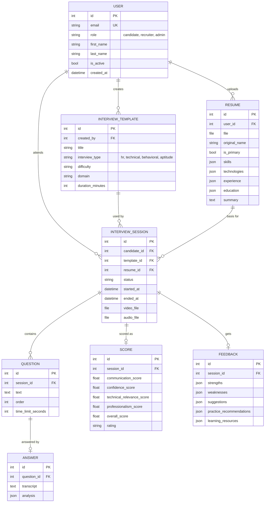

# Database Schema

PostgreSQL in Docker (SQLite fallback in development). Models live in `backend/apps/`.

## Scoring formula (from the SR document)
Overall = Communication x 30% + Confidence x 25% + Technical Relevance x 30% + Professionalism x 15%

| Score | Rating |
|---|---|
| 90 to 100 | Excellent |
| 75 to 89 | Good |
| 60 to 74 | Average |
| 40 to 59 | Needs Improvement |
| Below 40 | Poor |

## Status
- Milestone 1: User and Resume tables are in use.
- Interview, Question, Answer, Score and Feedback tables exist so later milestones need no schema rework.