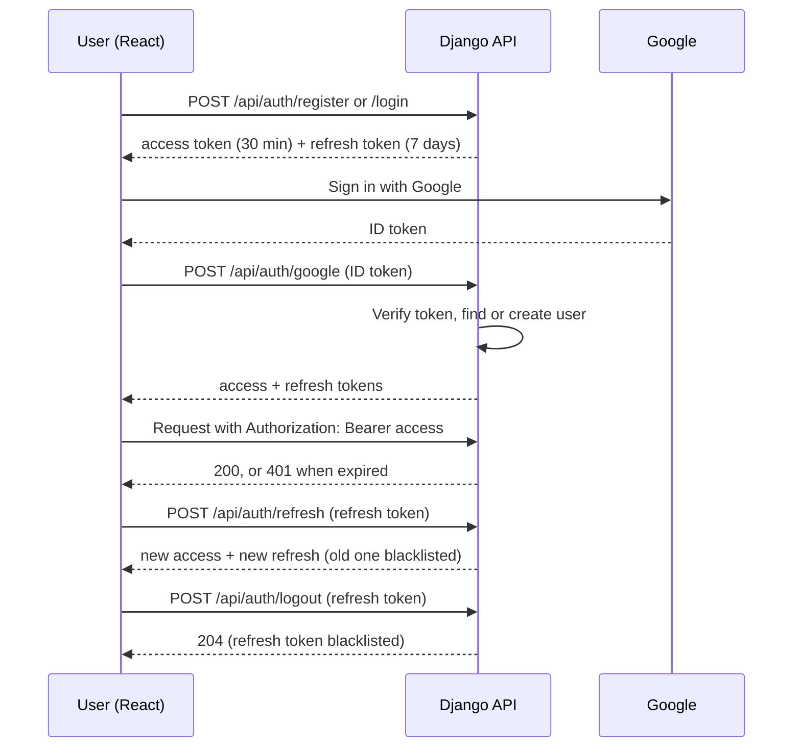
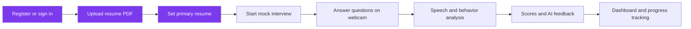
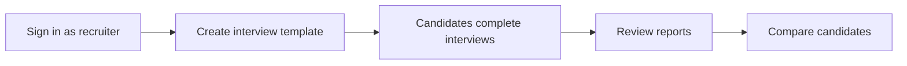
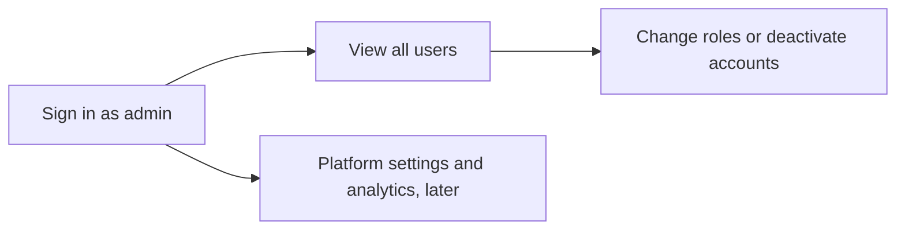

# SmartHire AI: Scope and Workflows

## Purpose
AI-powered mock interview and candidate assessment platform. Candidates practise technical, HR,
behavioral and aptitude interviews with webcam and microphone support and receive scored,
actionable feedback. Recruiters review analytics and reports. Admins manage the platform.

## Roles
| Role | Can do |
|---|---|
| Candidate | Upload resumes, attend mock interviews, view history and analytics, download reports |
| Recruiter | Review candidate analytics and reports, compare candidates, create interview templates, monitor sessions |
| Admin | Manage users and recruiters, configure the platform and AI settings, view platform-wide analytics |

## Milestone 1 scope (Weeks 1 and 2)
In scope: database schema, environment setup, authentication (JWT, Google OAuth2, sessions),
role-based access control, PostgreSQL, resume management (upload, list, view, set primary, delete).

Out of scope (later milestones): skill extraction, question generation, interview room, speech and
emotion analysis, scoring engine, analytics dashboards, notifications, cloud deployment.

## Workflow 1: Authentication

## Workflow 2: Candidate journey

Purple steps are built in Milestone 1.

## Workflow 3: Recruiter

## Workflow 4: Admin

## Security rules in place
- Passwords validated by Django's strength checks. New accounts can only be Candidate or Recruiter.
- Only admins can change roles. An admin cannot demote or deactivate themselves.
- Refresh tokens rotate on use and are blacklisted on logout.
- Resumes are served only to their owner through an authenticated endpoint.
- Uploads are limited to PDF, 5 MB each and 5 per user.